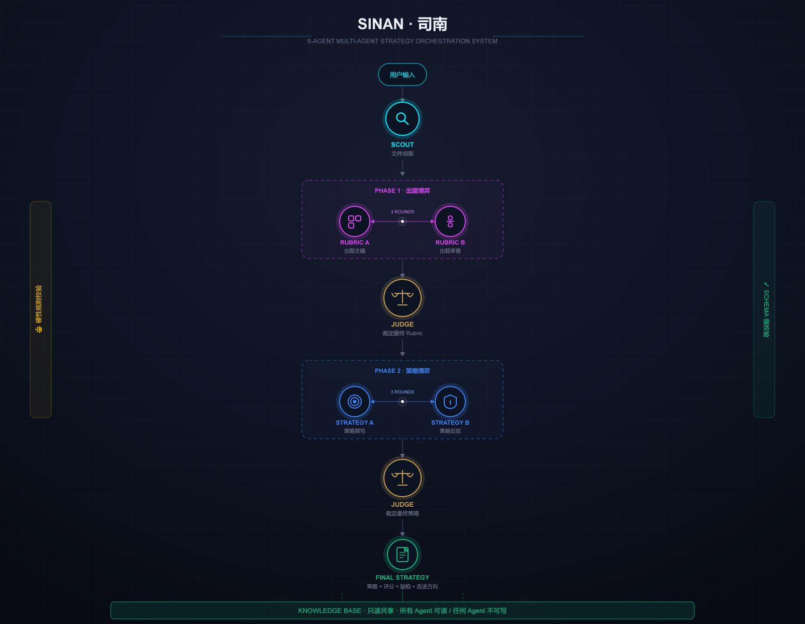
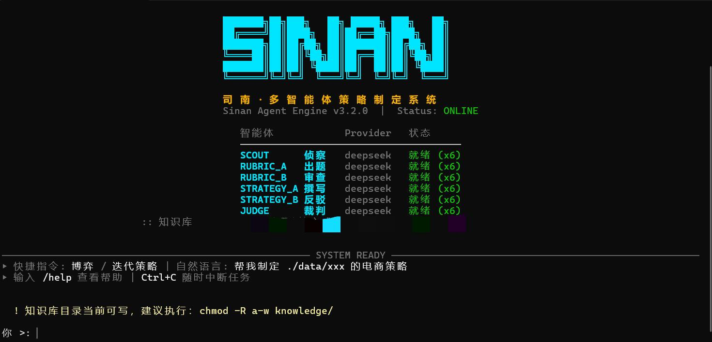

<div align="center">


# Sinan (Sinan-Agent-Team)

**Système multi-agents de formulation de stratégies**

Double jeu · Isolation du contexte · Base de connaissances partagée · Validation stricte JSON Schema · Rotation multi-Provider et multi-Key

<p align="center">

  <a href="https://github.com/Xu123-Bob/Sinan-Agent-Team/blob/main/LICENSE">
    
  </a>
  <a href="https://www.python.org/downloads/">
    
  </a>
</p>

<p align="center">
  <a href="README.cn.md">简体中文</a> |
  <a href="README.en.md">English</a> |
  <a href="README.ja.md">日本語</a> |
  <a href="README.ko.md">한국어</a> |
  <a href="README.es.md">Español</a> |
  <a href="README.fr.md">Français</a> |
  <a href="README.ru.md">Русский язык</a> |
</p>

</div>

----------
## Présentation
**Ce projet est un cadre de formulation de stratégies et d'évaluation des effets de stratégies multi-agents**
- Le produit construit conjointement un système de formulation et d'évaluation de stratégies via **Rule\Rubric\LLM-to-judge**
- Ce projet compte **6 agents** au total : 2 agents de génération de questions, 2 agents de décision, 1 agent de reconnaissance et 1 agent de jugement
- La couche Rule inclut les contraintes sur le contenu métier, ainsi que les contraintes sur la **structure de sortie des agents** (pour garantir que les agents produisent des sorties correctes)
- Le Rubric est élaboré via le **jeu de 2 agents de génération de questions**, chacun exposant son point de vue, et finalement l'**agent de décision effectue la confirmation finale**
- La formulation et l'évaluation des stratégies sont réalisées via la **discussion de 2 agents de formulation de stratégies**, et finalement l'**agent de décision effectue également la confirmation finale**
- L'analyse et l'acquisition de données et de connaissances professionnelles sont réalisées par **1 agent de reconnaissance**, qui scanne principalement `knowledge/`, `data/`, `output/`
- Les produits générés comprennent : **plan de stratégie, tableau de questions Rubric et manuscrit de discussion**, finalement enregistrés dans `knowledge/`. Lors de l'itération de nouvelles stratégies, l'**agent de reconnaissance scanne automatiquement**
- Ce projet est ma participation au Hackathon Jeunesse IA de Pékin 2026, où il a obtenu la 4e place à l'évaluation Alipay et a été recommandé au Concours d'agents intelligents Alipay

### Schéma de la structure multi-agents

<div align="center">
Schéma de la structure multi-agents
</div>

<p align="center">
  
</p>

### Présentation du produit  
URL statique : https://sinan-website.pages.dev/

---

## Caractéristiques principales

- **Architecture 6-Agent** : Reconnaissance / Groupe de génération de questions (A+B) / Groupe de stratégie (A+B) / Jugement, chacun avec ses responsabilités |
- **Isolation stricte du contexte** : Groupe de génération de questions ↔ Groupe de stratégie totalement isolés ; la mémoire privée du Judge ne fuit jamais |
- **Base de connaissances en lecture seule partagée** : `knowledge/` est lisible par tous les agents, mais aucun agent ne peut y écrire |
- **Double jeu en trois rounds** : Groupe Rubric A ⇄ B, groupe de stratégie A ⇄ B, chacun avec trois rounds de jeu |
- **Décision indépendante du Judge** : Le seul agent capable de voir tout le contexte, il ne produit que des décisions |
- **Validation stricte JSON Schema** : La sortie de chaque agent doit passer par Pydantic ; en cas d'échec, nouvelle tentative automatique 2 fois |
- **Double validation des règles dures avant et après** : Injectées dans le Prompt avant la génération, vérifiées indépendamment après la génération ; l'utilisateur peut personnaliser la ligne de base |
- **Multi-Provider et multi-Key** : Le même Provider prend en charge la rotation de plusieurs Keys ; chaque agent peut spécifier un modèle indépendamment |
- **Entrée de n'importe quel chemin** : Relatif / absolu / Windows / Linux / fichier unique / dossier ; Entrée pour analyser automatiquement |
- **N'importe quel domaine métier** : E-commerce / GitHub / AtomGit / Douyin / TikTok intégrés ; extensible et personnalisable |
- **CLI entièrement en chinois** : Rendu Typer + Rich, panneaux colorés, impression en temps réel du processus de débat |

---
## Interface de connexion
<div align="center">
Interface de connexion
</div>

<p align="center">
  
</p>


## Configuration requise (à lire en premier)
```
| Élément | Recommandé | Description |
|---|---|---|
| **Python** | **3.10 / 3.11 / 3.12** | ⭐ Fortement recommandé |
| Python 3.13 | Disponible | Certaines dépendances peuvent poser de petits problèmes |
| Python 3.14+ | ❌ **Non recommandé** | Problèmes de compatibilité connus avec editable install |
| Système d'exploitation | Windows / macOS / Linux | Prise en charge multiplateforme |
| Réseau | Nécessite l'accès à l'API LLM | DeepSeek / Kimi / Qwen, etc. |
```
> **En cas de problème d'installation ou de démarrage, exécutez d'abord le diagnostic** :
> ```bash
> python -m agent.doctor
> ```
> Il vérifiera en une fois la version de Python, les dépendances, l'intégrité du paquet agent, la méthode d'installation et le test de démarrage, et proposera des corrections.

---

## Installation (choisir 1 parmi 3 méthodes)

### Méthode 1 : Script en un clic (recommandé pour les débutants)

```bash
# Windows
scripts\install.bat

# Linux / macOS
bash scripts/install.sh
```

Le script vérifie automatiquement Python, crée le venv, installe les dépendances et exécute doctor pour valider.

### Méthode 2 : Installation manuelle (pour les développeurs familiarisés avec Python)

```bash
# Il est fortement recommandé d'utiliser un environnement virtuel
python -m venv .venv

# Activation (choisir 1 parmi 3)
source .venv/bin/activate         # Linux / macOS
.venv\Scripts\activate            # Windows CMD
.venv\Scripts\Activate.ps1        # Windows PowerShell

# Installation
pip install -e .
```

> **Attention aux utilisateurs de Python 3.13+** : Si après `pip install -e .` la commande `sinan` signale `ModuleNotFoundError: agent.core.xxx`, utilisez plutôt :
> ```bash
> pip install .
> ```
> Ou démarrez directement avec `python -m agent` (voir la section « Démarrage » ci-dessous).

### Méthode 3 : Docker (pour éviter les soucis d'environnement)

```bash
docker build -t sinan .

docker run -it --rm \
  -v $(pwd)/.env:/app/.env \
  -v $(pwd)/knowledge:/app/knowledge \
  -v $(pwd)/data:/app/data \
  -v $(pwd)/outputs:/app/outputs \
  sinan
```

Contourne complètement les problèmes de version Python, de compilation des dépendances et de différences système.

---

## Démarrage (3 méthodes équivalentes)

```bash
sinan                  # Commande installée par pip (la plus pratique)
python -m agent        # Alternative (à utiliser si la commande sinan échoue)
python -m agent.cli    # Autre alternative
```

**Les trois commandes sont totalement équivalentes** ; il suffit que l'une d'elles fonctionne.

Si `sinan` signale une erreur, utilisez directement `python -m agent` ; **inutile de chercher à résoudre le problème**.

---

## Démarrage rapide

### 1. Configurer le backend

```bash
cp .env.example .env
```

Éditez `.env` et saisissez **au moins une** API Key (configuration minimale) :

```env
SINAN_DEEPSEEK_API_KEY=sk-votre-clé
SINAN_DEFAULT_PROVIDER=deepseek
```

Supprimez tous les autres champs ; ces deux lignes suffisent.

> Pour les configurations avancées multi-modèles, pools multi-Keys et affectation par agent, voir [`USAGE.md`](USAGE.md).

### 2. Préparer la base de connaissances (facultatif)

```bash
mkdir -p knowledge
echo "# Normes de langage de l'entreprise\nÉviter les expressions absolues..." > knowledge/company_style.md
```

Elle sera chargée automatiquement au démarrage et servira de référence à tous les agents, mais aucun agent **ne peut y écrire**.

### 3. Vérifier la configuration

```bash
python -c "from agent.core.agent_config import summarize_configs; print(summarize_configs())"
```

Vous devriez voir le statut Provider et Key des 6 agents tous en ✅.

### 4. Exécuter

```bash
sinan
# ou
python -m agent
```

Ou générer directement en ligne de commande :

```bash
sinan generate ./data/ecommerce_v1 -d ecommerce
# ou
python -m agent generate ./data/ecommerce_v1 -d ecommerce
```

### 5. Consulter les produits

```bash
ls outputs/
# strategy_<domain>_<folder>_<ts>.md   ← Stratégie finale
# rubric_<domain>_<folder>_<ts>.json   ← Rubric final
# debate_<domain>_<folder>_<ts>.json   ← Enregistrement complet du débat
```

### 6. Les 6 agents
```
| Icône | Agent | Responsabilité | Configuration de modèle indépendante |
|------|-------|------|----------------|
| 🔍 | `SCOUT` | Reconnaissance de fichiers, identification du contenu des données | ✅ |
| 🧩 | `RUBRIC_A` | Rédacteur principal des questions (brouillon du Rubric) | ✅ |
| 🧩 | `RUBRIC_B` | Réviseur des questions (révision du Rubric) | ✅ |
| 🎯 | `STRATEGY_A` | Rédacteur de stratégie | ✅ |
| 🎯 | `STRATEGY_B` | Contradicteur de stratégie | ✅ |
| ⚖️ | `JUDGE` | Agent de jugement (décision finale + notation) | ✅ |
```

---

## Commandes CLI

```bash
# Chat interactif (recommandé pour les débutants)
sinan

# Génération en un clic
sinan generate <n'importe quel chemin> -d <domaine> [-o répertoire de sortie] [-k répertoire de base de connaissances]

# Évolution itérative (V1 → V2)
sinan evolve <ancienne_stratégie.md> <nouveau_chemin_de_données> -d <domaine>

# Comparer deux stratégies
sinan compare <stratégieA.md> <stratégieB.md> -d <domaine>

# Diagnostic de l'environnement
python -m agent.doctor
```

> Si la commande `sinan` n'est pas disponible, remplacez tout par `python -m agent <sous-commande>`.

### Domaines pris en charge

Domaines par défaut du système : `ecommerce` · `github` · `atomgit` · `douyin` · `tiktok` · `finance`

> L'utilisateur peut ajouter des données et des objectifs de tâche dans le dossier `data/`.

> L'utilisateur peut personnaliser de nouvelles règles de domaine dans `configs/rules.yaml`.

### Chemins pris en charge

- ✅ Chemin relatif (`./data/foo`)
- ✅ Chemin absolu (`/home/user/foo`, `D:\data\foo`)
- ✅ Fichier unique (`./goal.md`)
- ✅ Dossier entier (n'importe quel emplacement)
- ✅ Entrée directe → analyse intelligente du répertoire courant

---

## Base de connaissances

`knowledge/` est une **base de connaissances partagée en lecture seule**, disponible comme référence pour les 6 agents intelligents.

### Caractéristiques
- **Lecture partagée** : Tous les agents lisent le contenu de la base de connaissances comme référence avant de générer
- **Pas d'écriture** : La couche code `safe_io.safe_write` le bloque obligatoirement |
- **Renforcement physique** : Il est recommandé d'exécuter `chmod -R a-w knowledge/` (Linux/macOS) |
- **Ne brise pas l'isolation** : La base de connaissances est une référence publique statique, totalement étrangère à l'historique de jeu |
- **Taille contrôlable** : Tronquée à 8k caractères par fichier et 20k caractères au total, ajustable via `.env` |
- **Multi-format** : md / txt / docx / xlsx / csv / pptx / yaml / json |

### Contenu approprié

- Marque / normes de langage de l'entreprise
- Normes sectorielles / lignes rouges politiques
- SOP internes / documents de processus
- Modèles de stratégie réutilisables
- Cas de réussite historiques (anonymisés)
- Connaissances financières

### Contenu inapproprié

- Clés secrètes / mots de passe en clair
- Données privées des clients
- Gros binaires (images/vidéos)

---

## Configuration

### Configuration par couches (recommandée)

Chaque agent peut spécifier indépendamment le modèle et la key :

```env
SINAN_DEFAULT_PROVIDER=kimi/deepseek/GLM/Qwen

SINAN_RUBRIC_A_PROVIDER=kimi/deepseek/GLM/Qwen
SINAN_RUBRIC_B_PROVIDER=kimi/deepseek/GLM/Qwen
SINAN_STRATEGY_A_PROVIDER=kimi/deepseek/GLM/Qwen
SINAN_STRATEGY_B_PROVIDER=kimi/deepseek/GLM/Qwen
SINAN_JUDGE_PROVIDER=kimi/deepseek/GLM/Qwen
```

### Pool multi-Keys (limitation de débit / multi-comptes)

```env
# Séparées par des virgules
SINAN_DEEPSEEK_API_KEYS=sk-1,sk-2,sk-3

# Ou numérotées par ligne
SINAN_DEEPSEEK_API_KEY_1=sk-1
SINAN_DEEPSEEK_API_KEY_2=sk-2
SINAN_DEEPSEEK_API_KEY_3=sk-3
```

La bannière de démarrage affichera `✅ x3 rotation`, et tous les appels seront automatiquement répartis en round-robin.

### Nom de la variable de key pour chaque Provider
- DeepSeek : `SINAN_DEEPSEEK_API_KEY`
- Kimi / Moonshot : `SINAN_MOONSHOT_API_KEY`
- Qwen / Tongyi Qianwen : `SINAN_DASHSCOPE_API_KEY`
- GLM / Zhipu : `SINAN_ZHIPUAI_API_KEY`
- Ollama local : aucune key requise

### Personnalisation des règles dures

Éditez `configs/rules.yaml` :

```yaml
global:
  rules:
    - name: "Interdiction des termes absolus"
      type: "forbidden"
      value: "meilleur|premier|absolu"
      score: 20
      description: "La stratégie ne doit pas contenir d'expressions absolues"

healthcare:
  rules:
    - name: "Ne pas inclure de noms commerciaux de médicaments sur ordonnance"
      type: "forbidden"
      value: "aspirine|ibuprofène"
      score: 20
```

Types de règles pris en charge : `keyword` / `forbidden` / `regex` / `min_length` / `schema_field`.

---

## Points clés de l'architecture

### Garantie d'isolation du contexte
```
| Agent | Voir le jeu Rubric | Voir le jeu Strategy | Voir la mémoire du Judge | Voir la base de connaissances | Écrire dans la base de connaissances |
|---|:---:|:---:|:---:|:---:|:---:|
| 🔍 ScoutAgent | ✗ | ✗ | ✗ | ✓ | ✗ |
| 🧩 RubricAgentA / B | ✓ (son propre groupe uniquement) | ✗ | ✗ | ✓ | ✗ |
| 🎯 StrategyAgentA / B | ✗ (reçoit uniquement final_rubric) | ✓ (son propre groupe uniquement) | ✗ | ✓ | ✗ |
| ⚖️ JudgeAgent | ✓ | ✓ | ✓ (sa propre mémoire privée) | ✓ | ✗ |
```
### Validation stricte du Schema de sortie
```
| Agent | Schema de sortie |
|---|---|
| Scout | `ScoutReport` |
| RubricA / B | `RubricSchema` |
| StrategyA / B | `StrategySchema` |
| Judge | `RubricDecision` / `StrategyDecision` |
```
En cas d'échec, le message d'erreur est automatiquement renvoyé au LLM pour qu'il se corrige, avec un maximum de 2 tentatives.

### Défense en trois couches des règles dures

```
Avant la génération : rule_constraints injecté dans le Prompt → l'agent les respecte activement
Après la génération : RuleEngine.evaluate(final_strategy) → vérification et notation indépendantes
À l'écriture : safe_io.safe_write → bloque l'écriture dans la base de connaissances
```

---

## Dépannage

### Diagnostic en un clic (à exécuter en premier)

```bash
python -m agent.doctor
```

Vérifie :
- Version de Python
- Dépendances tierces
- Intégrité du paquet agent (24 modules)
- Méthode d'installation (editable / normale / répertoire source)
- Test de démarrage

Et fournit des **commandes de réparation concrètes** pour les problèmes.

### Aide-mémoire des problèmes courants

#### `sinan` signale `ModuleNotFoundError: No module named 'agent.core.xxx'`

**Cause** : Sous Python 3.13+, le mapping du finder de l'editable install est incomplet.

**Correction (choisir 1 parmi 3)** :

```bash
# Option A : passer à une installation normale
pip uninstall -y sinan-agent
pip install .

# Option B : utiliser directement la méthode de démarrage alternative
python -m agent

# Option C : créer un wrapper sinan.cmd sous Windows
# Voir TROUBLESHOOTING.md
```

#### La commande `sinan` est introuvable

```bash
# Utiliser le démarrage alternatif
python -m agent
```

Ou ajoutez `Scripts\` de Python à la variable d'environnement PATH.

#### Les dépendances ne s'installent pas / bloquent

**Cause** : La version de Python est trop récente et certains paquets ne sont pas encore adaptés.

**Correction** :
1. Passer à Python 3.12
2. Ou utiliser Docker : `docker build -t sinan . && docker run -it sinan`

#### `⚠ Les agents suivants n'ont pas d'API Key`

**Cause** : Le nom de la variable de key du provider correspondant dans `.env` est mal orthographié.

**Erreurs courantes** :

| Ce que vous avez écrit | Ce qu'il faut écrire |
|---|---|
| `SINAN_KIMI_API_KEY` | `SINAN_MOONSHOT_API_KEY` |
| `SINAN_QWEN_API_KEY` | `SINAN_DASHSCOPE_API_KEY` |
| `SINAN_GLM_API_KEY` | `SINAN_ZHIPUAI_API_KEY` |

#### `Échec de validation du Schema (après 2 tentatives)`

**Cause** : Le format JSON de sortie du LLM est instable (petit modèle / température élevée).

**Correction** : Attribuer un modèle plus puissant aux agents clés

```env
SINAN_RUBRIC_A_PROVIDER=deepseek
SINAN_JUDGE_PROVIDER=deepseek
```

> Pour plus d'éléments de dépannage, voir [`TROUBLESHOOTING.md`](TROUBLESHOOTING.md).

---

## Exemple de produits

`outputs/strategy_ecommerce_ecommerce_v1_20251104_141500.md` :

```markdown
# Stratégie d'opérations Q4 e-commerce

> Domaine : ecommerce | Score du Judge : 85/100 | Règles dures : 100/100 | Généré le 2025-11-04 14:15:00

## Objectif
Augmenter le GMV de 30 %, nouveaux clients 40 %, taux de réachat 25 %, ROI ≥ 3,0

## Promotions produits
...

- **Vente flash du produit phare A001** — Chaque mercredi, 2 heures limitées, diffusion sur le site + domaine privé
  (Responsable : équipe opérations | Horaire : chaque mercredi 20:00-22:00 | KPI : GMV par session ≥ 80 000)
```

`outputs/debate_ecommerce_ecommerce_v1_20251104_141500.json` :

```json
{
  "rubric_history": [...],   // Processus complet des trois rounds de jeu du groupe de questions
  "strategy_history": [...], // Processus complet des trois rounds de jeu du groupe de stratégie
  "judge_reasoning": "..."   // Explication de la décision du Judge
}
```

---

## Navigation de la documentation

| Document | Contenu |
|---|---|
| [`USAGE.md`](USAGE.md) | Manuel d'utilisation complet (10 scénarios + dépannage) |
| [`STRUCTURE.md`](STRUCTURE.md) | Structure du projet, responsabilités des fichiers, flux de données |
| [`TROUBLESHOOTING.md`](TROUBLESHOOTING.md) | Manuel de dépannage (recherche par message d'erreur) |
| [`knowledge/README.md`](knowledge/README.md) | Instructions d'utilisation de la base de connaissances |

---

## Développement

```bash
# Installer les dépendances de développement
pip install -e ".[all]"

# Exécuter les tests
pytest

# Lint
ruff check agent/

# Formatage
ruff format agent/

# Diagnostic de l'environnement
python -m agent.doctor
```

---

## License

[Apache-2.0](apach-2.0)

---

## 🙏 Remerciements

- [OpenAI Python SDK](https://github.com/openai/openai-python) — Connexion LLM unifiée
- [Typer](https://typer.tiangolo.com/) + [Rich](https://rich.readthedocs.io/) — CLI élégante
- [Pydantic](https://docs.pydantic.dev/) — Validation stricte de Schema
- [DeepSeek](https://deepseek.com/) / [Kimi](https://kimi.moonshot.cn/) / [Qwen](https://dashscope.aliyun.com/) / [GLM](https://open.bigmodel.cn/) — Capacité des modèles backend
- [baize](https://github.com/Xu123-Bob/Baize) — Agent développé par moi-même
- **Merci également à Beijing News et Shell Finance ; cette œuvre a obtenu 4/26 à l'évaluation Alipay et 6/26 au concours lors du Hackathon Jeunesse IA 2026 organisé, et a été recommandée au Concours d'agents intelligents Alipay**